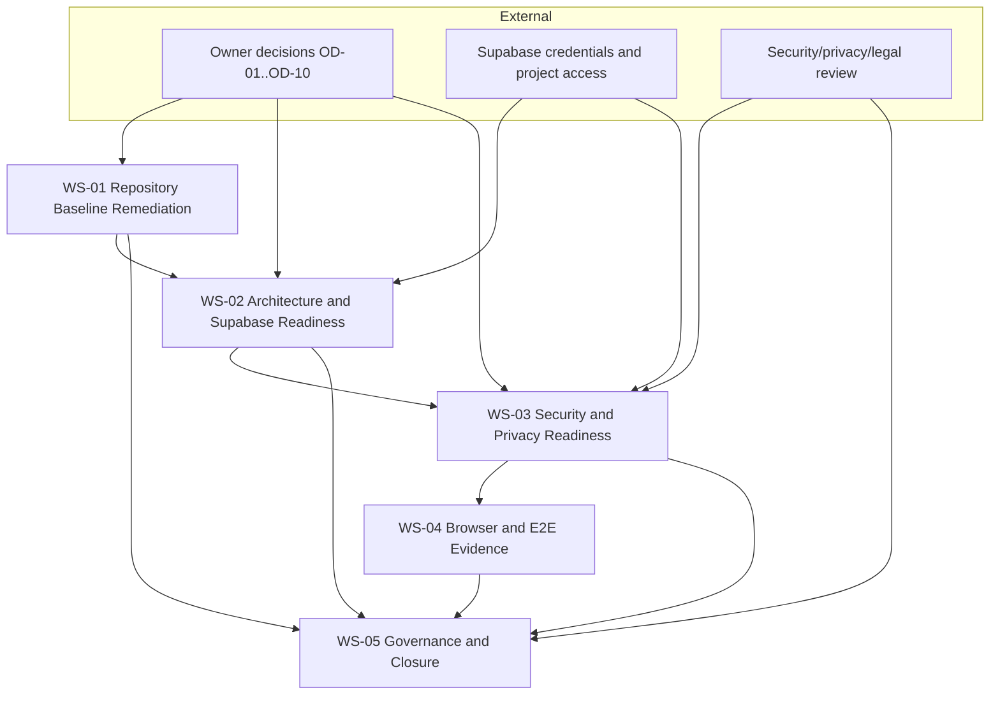

# Phase 0 Remediation Backlog

## Executive summary

- **Audit outcome:** OUTCOME C — NOT READY FOR PHASE 1
- **Branch:** `main`
- **HEAD:** `3695a89`
- **Working tree:** clean at the time of this audit.
- **Requirements baseline:** [BLUEPRINT-REQUIREMENT-BASELINE.md](../product/BLUEPRINT-REQUIREMENT-BASELINE.md)
- **Approved owner decisions:** [PHASE-0-OWNER-DECISION-RECORD.md](PHASE-0-OWNER-DECISION-RECORD.md)
- **Status of current evidence:** The repository contains a prototype UI, routing, demo data, and test/build evidence, but backend security controls, external service configuration, runtime browser verification, and full repository readiness remain unverified.
- **Remediation principle:** This backlog defines the smallest safe, measurable set of work needed to make Phase 0 eligible for a re-audit. It does not implement features or changes in this task.

This document preserves the approved requirement baseline and owner decisions and does not introduce new product requirements or implementation claims.

## Scope and authority

### Authoritative inputs

- [BLUEPRINT-REQUIREMENT-BASELINE.md](../product/BLUEPRINT-REQUIREMENT-BASELINE.md)
- [PHASE-0-OWNER-DECISION-RECORD.md](PHASE-0-OWNER-DECISION-RECORD.md)
- [PHASE-0-IMPLEMENTATION-READINESS.md](PHASE-0-IMPLEMENTATION-READINESS.md)
- [PHASE-0-SECURITY-GAP-ANALYSIS.md](PHASE-0-SECURITY-GAP-ANALYSIS.md)
- [PHASE-0-ARCHITECTURE-ASSESSMENT.md](PHASE-0-ARCHITECTURE-ASSESSMENT.md)
- [PHASE-0-REPOSITORY-INVENTORY.md](PHASE-0-REPOSITORY-INVENTORY.md)
- [PHASE-0-ROUTE-FUNCTIONAL-AUDIT.md](PHASE-0-ROUTE-FUNCTIONAL-AUDIT.md)
- [PROPOSED-PHASE-1-BACKLOG.md](../architecture/PROPOSED-PHASE-1-BACKLOG.md)
- [AGENTS.md](../../AGENTS.md)
- [package.json](../../package.json)

### Audit decision retained

Phase 0 remains **NOT READY FOR PHASE 1** until the required evidence is produced and the gating conditions are satisfied. Ownership and architecture decisions are approved, but implementation and verification evidence remain missing.

## Workstream status summary

| Workstream                                | Status       | Summary                                                                                                                            |
| ----------------------------------------- | ------------ | ---------------------------------------------------------------------------------------------------------------------------------- |
| WS-01 Repository Baseline Remediation     | BLOCKED      | Repository baseline and lint failure are active blockers to reproducibility and CI evidence.                                       |
| WS-02 Architecture and Supabase Readiness | BLOCKED      | Provider and migration ownership are approved at direction level, but service configuration and operating evidence remain missing. |
| WS-03 Security and Privacy Readiness      | BLOCKED      | Auth, consent, guardian relationship, RLS, and audit controls require implementation and verification before production use.       |
| WS-04 Browser and E2E Evidence            | NOT VERIFIED | Routes and workflows are catalogued, but no independent browser or E2E evidence exists.                                            |
| WS-05 Governance and Closure              | BLOCKED      | Required owner approvals and closure evidence are not yet recorded.                                                                |

## Status taxonomy and verification model

The backlog distinguishes between task status and verification status.

- **NOT STARTED**: work has not begun.
- **IN PROGRESS**: work is actively being performed.
- **BLOCKED**: a specific dependency, external condition, or required decision prevents progress.
- **NOT VERIFIED**: implementation or evidence has not been independently verified.
- **READY FOR VERIFICATION**: implementation or documentation is complete and ready for review.
- **VERIFIED**: acceptance criteria passed with recorded evidence.
- **NOT APPLICABLE**: justified exclusion.

A task is marked **BLOCKED** only when there is a specific dependency or condition that prevents progress. Missing evidence alone does not equal **BLOCKED**; it may be **NOT VERIFIED** or **NOT STARTED** depending on task stage.

For every item, the backlog must record both:

1. **Work status**: whether the work is not started, in progress, blocked, or ready for verification.
2. **Verification status**: whether the output has been independently validated or is still unverified.

This distinction is required because approved decisions do not equal implementation evidence and because route validation without server-side security evidence is not equivalent to verified backend enforcement.

## Supabase evidence requirements

Supabase evidence must be recorded as separate states: documented, configured, connected, functional, and tested. A documented design does not count as configured or connected evidence.

For every Supabase-related remediation item, the evidence inventory must include, without exposing secrets:

- **Supabase project identity**: project name, environment label, owner, and region if available; do not include service-role keys, connection strings, or secret values.
- **Development, staging, and production separation**: explicit environment mapping and ownership for each environment.
- **Supabase URL and public client configuration**: URL, anonymous/public client configuration, and environment mapping.
- **Auth configuration**: provider type, session rules, auth settings, recovery configuration, and verification status.
- **PostgreSQL schema and migration history**: migration files or approved repository workflow evidence, schema inventory, and migration sequencing status.
- **RLS policy inventory**: table-by-table policy list, required operations covered, and whether policies were reviewed or tested.
- **Storage bucket and policy inventory**: bucket names, access scopes, encryption/retention if applicable, and policy review status.
- **Backup and recovery evidence**: restore strategy, backup schedule, retention policy, and operational ownership if available.
- **Connection and operational verification**: whether the project is connected, usable, and functionally verified in the approved environment.

Evidence may be recorded as:

- **Documented**: architecture or policy exists in writing.
- **Configured**: settings exist in the environment configuration.
- **Connected**: environment is reachable and connected to a valid project instance.
- **Functional**: target behavior is working under test.
- **Tested**: negative and positive checks have been executed and recorded.

The backlog does not permit an item to be marked as “verified” based on a config document alone.

## Security negative-test evidence requirements

Security remediation items must define measurable negative-test evidence using synthetic identities only. These tests must never use real youth-player data.

Each negative-test record must include:

- synthetic test identity
- preconditions
- action
- expected result
- actual result
- HTTP status or equivalent result where applicable
- evidence reference

Required negative tests include:

- unauthenticated access denial
- authenticated but unauthorized access denial
- cross-tenant data access denial
- unverified guardian access denial
- revoked guardian relationship access denial
- missing or revoked purpose-specific consent denial
- unauthorized storage access denial
- audit-log access restriction

Required evidence includes the result of the action and the matching authorization decision. The backlog must distinguish a failed login or invalid session from a validly authenticated-but-unauthorized request. It must not infer success from UI-only behavior.

## Browser/E2E evidence requirements

Both automation and reproducible manual testing are acceptable where justified, provided each test has sufficient evidence.

Each browser/E2E evidence record must include:

- route or workflow
- browser and version
- viewport dimensions
- synthetic test identity
- preconditions
- test steps
- expected result
- actual result
- screenshot or test-run evidence
- pass/fail status

The backlog must explicitly distinguish:

- **prototype UI verification**: route loads, renders, and basic interaction checks only.
- **backend verification**: server-side behavior, authorization, and data behavior.
- **authorization and RLS verification**: negative tests and cross-tenant denial checks.

Prototype UI verification alone does not satisfy the security or data-access closure requirements.

## Detailed remediation backlog

### Workstream WS-01 — Repository Baseline Remediation

| Epic ID | Workstream | Feature ID | Story ID  | Objective                                                     | Current evidence                                                                                                      | Current status | Scope                                                                                           | Dependencies                       | Acceptance criteria                                                                                                     | Verification method                    | Required evidence artifact                                     | Responsible role | Risk if unresolved                                        | Complexity | Owner approval required |
| ------- | ---------- | ---------- | --------- | ------------------------------------------------------------- | --------------------------------------------------------------------------------------------------------------------- | -------------- | ----------------------------------------------------------------------------------------------- | ---------------------------------- | ----------------------------------------------------------------------------------------------------------------------- | -------------------------------------- | -------------------------------------------------------------- | ---------------- | --------------------------------------------------------- | ---------- | ----------------------- |
| EP-WS01 | WS-01      | F-WS01-01  | S-WS01-01 | Adopt a single package-manager policy and canonical lockfile. | `package.json` and lockfiles show mixed package-manager artifacts; README may document npm; Bun files remain present. | BLOCKED        | Choose npm as the only official package-manager path and document it consistently.              | Owner decision OD-01               | `package-lock.json` is the canonical lockfile; README and CI use npm; Bun artifacts are not treated as active workflow. | Repo inspection and policy review      | Approved package-manager policy document or README/CI evidence | Engineering lead | CI drift and inconsistent install behavior                | S          | Yes                     |
| EP-WS01 | WS-01      | F-WS01-02  | S-WS01-02 | Enforce LF repository-wide and resolve Prettier warnings.     | Fresh `npm run lint` failed with `8745` Prettier CRLF deletions.                                                      | BLOCKED        | Standardize LF for repository text files; do not modify unrelated repo config without approval. | OD-02                              | Lint passes under the approved LF policy.                                                                               | `npm run lint` after policy change     | Clean lint output and chosen line-ending standard              | Engineering lead | Repo remains non-reproducible and review-heavy            | S          | Yes                     |
| EP-WS01 | WS-01      | F-WS01-03  | S-WS01-03 | Produce reproducible install and verification evidence.       | `npm install` passed historically; build/test/typecheck are available, but lint remains failing.                      | PARTIAL        | Create a controlled verification matrix for install, test, build, typecheck, and lint.          | OD-01, OD-02, F-WS01-01, F-WS01-02 | Clean install + passing test/build/typecheck/lint on a controlled release commit.                                       | Exact commands and exit codes recorded | Verification log with commands, outputs, and pass/fail states  | QA + DevSecOps   | Reproducibility remains unstable, blocking CI and signoff | M          | Yes                     |

### Workstream WS-02 — Architecture and Supabase Readiness

| Epic ID | Workstream | Feature ID | Story ID  | Objective                                                           | Current evidence                                                                                                                                    | Current status | Scope                                                                                                   | Dependencies               | Acceptance criteria                                                                           | Verification method                                           | Required evidence artifact                                 | Responsible role                  | Risk if unresolved                                                    | Complexity | Owner approval required |
| ------- | ---------- | ---------- | --------- | ------------------------------------------------------------------- | --------------------------------------------------------------------------------------------------------------------------------------------------- | -------------- | ------------------------------------------------------------------------------------------------------- | -------------------------- | --------------------------------------------------------------------------------------------- | ------------------------------------------------------------- | ---------------------------------------------------------- | --------------------------------- | --------------------------------------------------------------------- | ---------- | ----------------------- |
| EP-WS02 | WS-02      | F-WS02-01  | S-WS02-01 | Define the actual backend boundary and provider configuration path. | OD-03 approves Supabase; repo has no verified project configuration or service connection.                                                          | BLOCKED        | Confirm provider, environment, and service topology.                                                    | OD-03, OD-05, OD-08, OD-09 | Provider and topology are documented, environment-separated, and externally verifiable.       | Repo review plus provider dashboard or configuration evidence | Backend architecture document with environment map         | Principal architect               | Architecture may be disconnected from actual deployment               | M          | Yes                     |
| EP-WS02 | WS-02      | F-WS02-02  | S-WS02-02 | Reconcile migration ownership and repository workflow conflict.     | [AGENTS.md](../../AGENTS.md) says Lovable manages database schema and migrations; OD-04 says repository-managed migrations are the source of truth. | BLOCKED        | Resolve workflow ownership, review process, and migration authority.                                    | OD-04, AGENTS.md           | One authoritative migration workflow is documented and accepted by the platform owner.        | Policy reconciliation + workflow review                       | Decision reconciliation note and workflow ownership record | Platform owner + engineering lead | Migrations can be applied inconsistently or outside policy            | M          | Yes                     |
| EP-WS02 | WS-02      | F-WS02-03  | S-WS02-03 | Verify Supabase project configuration and environment separation.   | No actual project config, auth config, storage config, or env evidence was found in repo.                                                           | NOT VERIFIED   | Confirm project URLs, API keys, environment separation, and storage setup only via authorized workflow. | OD-03, OD-05, OD-08        | Project variables, auth, storage, DB, and environment separation are documented and verified. | Platform config validation (read-only, no secrets exposed)    | Environment matrix and config inventory                    | DevSecOps + platform owner        | Deployment may be insecure or misconfigured                           | M          | Yes                     |
| EP-WS02 | WS-02      | F-WS02-04  | S-WS02-04 | Define frontend/backend/data boundaries with evidence.              | Current code is prototype UI using mock data; no API layer or server functions found.                                                               | PARTIAL        | Separate original UI prototype from backend service contract and evidence requirements.                 | OD-03, OD-05, OD-08, OD-09 | Boundary is explicit with server-side enforcement and tested API interfaces.                  | Architecture review and implementation evidence               | Interface and backend contract matrix                      | Principal architect               | The app may continue to confuse UI state with real policy enforcement | M          | Yes                     |

### Workstream WS-03 — Security and Privacy Readiness

| Epic ID | Workstream | Feature ID | Story ID  | Objective                                                              | Current evidence                                                                                           | Current status | Scope                                                                                                       | Dependencies                           | Acceptance criteria                                                                                               | Verification method                             | Required evidence artifact                        | Responsible role                                | Risk if unresolved                          | Complexity | Owner approval required |
| ------- | ---------- | ---------- | --------- | ---------------------------------------------------------------------- | ---------------------------------------------------------------------------------------------------------- | -------------- | ----------------------------------------------------------------------------------------------------------- | -------------------------------------- | ----------------------------------------------------------------------------------------------------------------- | ----------------------------------------------- | ------------------------------------------------- | ----------------------------------------------- | ------------------------------------------- | ---------- | ----------------------- |
| EP-WS03 | WS-03      | F-WS03-01  | S-WS03-01 | Establish Supabase Auth and session lifecycle policy.                  | No auth middleware or verified provider configuration exists.                                              | BLOCKED        | Define authentication provider, session validation, account recovery, and lifecycle.                        | OD-05, OD-09                           | Auth provider is configured and verified; server accepts only valid authenticated sessions.                       | Read-only config review + actual auth test plan | Auth architecture and verification checklist      | Security architect                              | Identity spoofing risk                      | L          | Yes                     |
| EP-WS03 | WS-03      | F-WS03-02  | S-WS03-02 | Model guardian-player relationships and verification workflow.         | UI shows static guardian fields and role selection; no real relationship verification exists.              | BLOCKED        | Defined many-to-many model, verification evidence, revocation, dispute path, and permission checks.         | OD-06, OD-09, OD-10                    | Relationship status, verification state, dispute path, and denial tests are documented and verified.              | Design review and negative tests                | Guardian relationship model and test evidence     | Security architect + product owner              | Unauthorized guardian access                | L          | Yes                     |
| EP-WS03 | WS-03      | F-WS03-03  | S-WS03-03 | Define purpose-specific consent lifecycle and enforcement.             | UI demonstrates local state and toast actions; no audited server-side consent enforcement found.           | BLOCKED        | Record consent giver, purpose, notice version, history, review, renewal, and revocation.                    | OD-07, OD-09, OD-10                    | Consent state is stored, revocable, auditable, and enforced server-side.                                          | Design review + server-side negative tests      | Consent policy and test matrix                    | Privacy + security owners                       | Consent bypass and improper data disclosure | L          | Yes                     |
| EP-WS03 | WS-03      | F-WS03-04  | S-WS03-04 | Implement tenant isolation with PostgreSQL RLS and default-deny.       | No actual RLS or server authorization evidence is present.                                                 | BLOCKED        | Define tenant model, required tables, policies, and cross-tenant denial tests.                              | OD-08, OD-09                           | RLS covers relevant tables; cross-tenant access is denied in negative tests.                                      | DB policy review + test results                 | RLS policy matrix and security test log           | Database security reviewer + Supabase architect | Data leakage across organizations           | L          | Yes                     |
| EP-WS03 | WS-03      | F-WS03-05  | S-WS03-05 | Define and test server-side authorization model.                       | Current app uses client-side role navigation and localStorage; no business API or auth boundary was found. | BLOCKED        | Implement default-deny access checks using RBAC + resource + relationship + attribute + purpose dimensions. | OD-09, OD-08, OD-05                    | Negative tests cover anonymous, wrong-role, wrong-resource, wrong-tenant, revoked-consent, and direct-API bypass. | Security testing and code review                | Authorization matrix and test evidence            | Security architect                              | Authorization bypass                        | L          | Yes                     |
| EP-WS03 | WS-03      | F-WS03-06  | S-WS03-06 | Create centralized audit logging and retention policy.                 | App shows local auditTrail UI but no durable security logging path.                                        | BLOCKED        | Define append-only security logs, restricted access, event schema, and retention/legal-hold policy.         | OD-10, OD-07, OD-06                    | Sensitive events are logged with actor/resource/tenant/outcome and retention policy documented.                   | Security log review + policy approval           | Audit log schema and retention schedule           | DevSecOps + security owner                      | Untraceable or tampered actions             | M          | Yes                     |
| EP-WS03 | WS-03      | F-WS03-07  | S-WS03-07 | Confirm data minimization, synthetic provenance, and retention safety. | Mock data includes child-like fields; provenance is not confirmed.                                         | BLOCKED        | Separate synthetic demo data from real records and document privacy posture.                                | OD-07, OD-10, data provenance findings | Synthetic provenance is confirmed or data is removed; minimization policy is defined.                             | Data review and policy signoff                  | Data provenance checklist and privacy review note | Privacy/legal owner + product owner             | Real child data risk                        | M          | Yes                     |

### Workstream WS-04 — Browser and E2E Evidence

| Epic ID | Workstream | Feature ID | Story ID  | Objective                                                      | Current evidence                                                  | Current status | Scope                                                                                   | Dependencies                             | Acceptance criteria                                                    | Verification method                                 | Required evidence artifact    | Responsible role        | Risk if unresolved                                           | Complexity | Owner approval required |
| ------- | ---------- | ---------- | --------- | -------------------------------------------------------------- | ----------------------------------------------------------------- | -------------- | --------------------------------------------------------------------------------------- | ---------------------------------------- | ---------------------------------------------------------------------- | --------------------------------------------------- | ----------------------------- | ----------------------- | ------------------------------------------------------------ | ---------- | ----------------------- |
| EP-WS04 | WS-04      | F-WS04-01  | S-WS04-01 | Verify all 16 routes load and render in a browser.             | Route inventory exists; no browser validation evidence was found. | NOT VERIFIED   | Route smoke test across desktop and mobile viewports.                                   | WS-01 baseline, platform environment     | All routes load and render with no critical runtime exception.         | Browser automation or manual reproducible test plan | Route smoke-test report       | QA lead                 | Broken navigation and runtime errors remain hidden           | M          | No                      |
| EP-WS04 | WS-04      | F-WS04-02  | S-WS04-02 | Validate core workflows end-to-end.                            | UI is prototype-only; no end-to-end verification exists.          | NOT VERIFIED   | Test player, parent, guardian, SSB, coach, referee, scout, and association flows.       | WS-03 security + WS-02 service readiness | Core workflows execute with valid data and expected state transitions. | E2E test evidence                                   | Workflow test report          | QA lead + product owner | Feature behavior may fail under real conditions              | L          | No                      |
| EP-WS04 | WS-04      | F-WS04-03  | S-WS04-03 | Verify denied-access and cross-tenant behavior in the browser. | Security review confirms no server-side enforcement exists.       | BLOCKED        | Negative tests for unauthorized access, consent revocation, and cross-tenant isolation. | WS-03                                    | Denied-access flows fail correctly and display appropriate state.      | Browser/security test evidence                      | Negative security test report | QA + security engineer  | Cross-tenant exposure and consent bypass remain undiscovered | L          | Yes                     |

### Workstream WS-05 — Governance and Closure

| Epic ID | Workstream | Feature ID | Story ID  | Objective                                                                               | Current evidence                                                                                     | Current status | Scope                                                                   | Dependencies                 | Acceptance criteria                                                             | Verification method               | Required evidence artifact                 | Responsible role                         | Risk if unresolved                                        | Complexity | Owner approval required |
| ------- | ---------- | ---------- | --------- | --------------------------------------------------------------------------------------- | ---------------------------------------------------------------------------------------------------- | -------------- | ----------------------------------------------------------------------- | ---------------------------- | ------------------------------------------------------------------------------- | --------------------------------- | ------------------------------------------ | ---------------------------------------- | --------------------------------------------------------- | ---------- | ----------------------- |
| EP-WS05 | WS-05      | F-WS05-01  | S-WS05-01 | Obtain product-owner signoff on scope, undefined requirements, and readiness decisions. | BRB-001 established the baseline; workflow acceptance criteria remain undefined.                     | BLOCKED        | Confirm scope, missing criteria, and explicit owner decisions.          | BRB-001, OD-01 through OD-10 | Product owner records unresolved requirements and acceptance scope.             | Review signoff record             | Signed or recorded product-owner checklist | Product owner                            | Scope creep or hidden requirements                        | S          | Yes                     |
| EP-WS05 | WS-05      | F-WS05-02  | S-WS05-02 | Obtain architecture and platform review.                                                | Architecture is approved only at direction level; actual provider and deployment evidence is absent. | BLOCKED        | Review backend architecture, env separation, and service ownership.     | OD-03, OD-04, OD-08, OD-09   | Architecture review is recorded and unresolved issues are tracked.              | Review artifact or meeting record | Architecture approval record               | Principal architect + platform owner     | Architectural drift and unknown operational risk          | M          | Yes                     |
| EP-WS05 | WS-05      | F-WS05-03  | S-WS05-03 | Obtain security and privacy reviews for youth-player data.                              | Security review remains incomplete and data provenance is unconfirmed.                               | BLOCKED        | Review guardian, consent, audit, retention, and minimization decisions. | WS-03, OD-06, OD-07, OD-10   | Security/privacy review notes are documented and action items assigned.         | Review artifact                   | Security/privacy review checklist          | Security architect + privacy/legal owner | Legal and security exposure                               | M          | Yes                     |
| EP-WS05 | WS-05      | F-WS05-04  | S-WS05-04 | Establish closure evidence and final re-audit gate.                                     | Closure evidence is partial and not yet enough for Phase 1 planning.                                 | BLOCKED        | Assemble the final evidence package for a new closure audit.            | All prior workstreams        | Required evidence is complete and traceable; no unsupported PASS claim remains. | Closure checklist review          | Final closure evidence package             | Technical project manager                | Re-audit may fail again without a structured evidence set | S          | Yes                     |

## Dependency graph

## Critical path

The critical path is:

1. WS-01 repository baseline remediation.
2. WS-02 architecture and Supabase readiness.
3. WS-03 security and privacy readiness.
4. WS-04 browser and E2E evidence.
5. WS-05 governance and final closure review.

This ordering is required because browser/security evidence cannot be trusted until the repository and backend path are defined and verified. The required owner decision and platform access items must also be in place before final closure evidence is credible.

## Parallelizable work

The following can proceed in parallel once owners and external access are available:

- Package-manager policy and LF/lint cleanup (WS-01)
- Supabase project verification and environment mapping (WS-02)
- Security design and policy definition (WS-03)
- Browser route smoke testing and workflow planning (WS-04)
- Governance/review packaging (WS-05)

Parallel work is still subject to owner approval and external-service access.

## Blocked by external credentials or environment

- Supabase project access and configuration verification.
- Real provider and deployment evidence.
- Security/privacy/legal review records.
- Browser automation environment, if a real browser is required.

These are not implementation tasks; they are evidence-gathering dependencies.

## Blocked by specialist review

- Security architecture signoff.
- Privacy/legal review for youth-player data handling.
- Platform/operations review for migration and environment ownership.
- Product owner scope signoff for omitted workflow details.

## Execution boundaries

The following remain outside scope for this remediation planning document:

- Modifying application source code.
- Modifying configuration.
- Installing dependencies.
- Deleting files.
- Modifying Supabase settings.
- Creating or applying migrations.
- Changing database policies.
- Committing or pushing.
- Starting Phase 1 implementation.

This document only defines the safe, evidence-driven remediation tasks required for a new closure audit.

## Definition of Phase 0 Remediation Complete

A remediation item is complete only when all of the following are satisfied:

1. The required implementation or approved documentation action is complete.
2. Its acceptance criteria are satisfied.
3. Verification has been performed with actual evidence.
4. Evidence is recorded and traceable.
5. No unsupported PASS claim remains.
6. The work item has been marked with the correct work status and verification status.

### Workstream completion conditions

#### WS-01 complete when:

- npm is the only official package manager.
- repository lockfile policy is documented and consistent.
- LF is enforced and lint passes without CRLF errors.
- install, test, build, typecheck, and lint are all verified on the audited commit.

#### WS-02 complete when:

- Supabase provider configuration and environment responsibilities are verified.
- migration ownership conflict is reconciled and workflow is documented.
- frontend/backend/data boundaries are explicitly stated and supported by evidence.

#### WS-03 complete when:

- auth, guardian, consent, RLS, authorization, audit logging, minimization, and retention controls are implemented and tested.
- negative security tests cover anonymous access, wrong-role access, wrong-tenant access, revoked consent, revoked guardian relationships, and direct API bypass.

#### WS-04 complete when:

- all 16 routes are validated in a real browser or equivalent automation.
- core workflows and denied-access flows are tested.
- route smoke evidence is recorded.

#### WS-05 complete when:

- product, architecture, security, privacy/legal, and platform review artifacts are recorded.
- closure evidence package is complete and records unresolved items explicitly.

## Owner decisions or approvals still required

The following remain required before final closure can be considered:

- Product owner confirmation of missing workflow acceptance criteria.
- Platform owner decision on Supabase and migration ownership.
- Security review for auth, guardian, consent, authorization, audit, and retention.
- Privacy/legal review for child-data handling and retention policies.
- Architecture owner review for backend/provider boundary and environment separation.
- Final closure reviewer signoff after all evidence is produced.

Do not invent names or approval records.

## External dependencies and missing evidence

- Supabase project access and configuration.
- Environment variables and service credentials for backend verification.
- Real browser automation environment.
- Security/privacy/legal review access.
- Named owners or signoff artifacts.

These items are not implementation tasks; they are required evidence-gathering dependencies.

## Proposed remediation execution order

1. **Repository baseline remediation (WS-01)**
2. **Architecture and Supabase readiness (WS-02)**
3. **Security and privacy readiness (WS-03)**
4. **Browser and E2E evidence (WS-04)**
5. **Governance and closure evidence (WS-05)**
6. **Final re-audit for closure**

This order prevents false confidence from passing documentation without backend verification or browser evidence.

## Repository change summary

This task created only the documentation file below:

- [PHASE-0-REMEDIATION-BACKLOG.md](PHASE-0-REMEDIATION-BACKLOG.md)

No source code, configuration, dependency, database, migration, or Supabase files were modified.

## Final status

**PHASE 0 — NOT READY FOR PHASE 1**

This status remains unchanged even after creating the remediation backlog, because a backlog is not evidence of implementation or closure.
